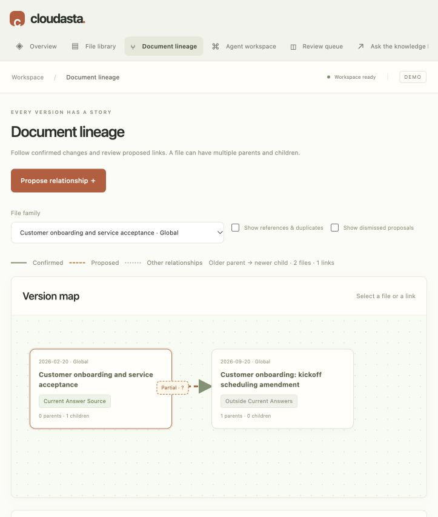

# Document lineage

Open **Document lineage** in the English administrator UI. Select a file family, or All files. Version arrows run from the earlier parent to the later child; the stored governance relation still runs from the new source to its old target. Each file supports multiple parents and children. A merge is represented by one replacement link per parent, with explicit clause coverage; a split has multiple children covering separate clauses.

Confirmed version links are solid, proposals are dashed, and dismissed proposals are hidden unless requested. References, duplicates, dependencies, conflicts and quarterly coexistence are separate contextual links; enable **Show references & duplicates** to inspect them. They do not become version ancestry. Parent/child counts include visible proposals, whose labels distinguish their status.

Click a file for its approval, effective/expiry dates, parent/child list and clauses currently eligible for answers. Click a link for its type, covered clauses, original cited passages, proposal reason, actor and decision information. Eligibility uses the same rules as retrieval, rather than assuming the newest node is current.

**Propose relationship** creates a pending item. **Revise link** changes a pending proposal's type, clause coverage and reason, preserving its previous contents and audit. The parent and child are locked when editing; dismiss and create another proposal to correct the pair. Original matching clauses are attached as evidence. Review evidence and confirm through the existing review queue. **Dismiss link** resolves only that proposal and preserves both files and their approval states. Confirmed relationships are not silently edited; Activity & recovery provides version-checked rollback when compatible.

The server rejects self links, cross-client/domain replacements, unsupported clause coverage, cycles and replacement links without verified dates on both files. Overlapping successor branches with different content cannot execute automatically; the administrator sees a branch warning and must decide explicitly. Byte-identical exports do not count as different competing revisions. Context links are excluded from replacement cycle checks. Stale links cannot be confirmed against changed file versions. Future changes still cannot activate early. Recording a context relationship does not approve its draft source.

The implementation projects existing relation/review records; it does not regenerate the corpus or alter the completed Qwen benchmark. Historical unsupported proposals remain visible with warnings until reviewed. This UI makes relationships inspectable; it does not independently verify model claims or fix the previously measured answer conflict detector.

Validation: four lineage tests cover multiple parents/children, cycles, partial clause eligibility, competing branches, revisions, dismissal, invalid/stale proposals and draft isolation. The HTTP workflow exercises proposal creation, revision and confirmation. The original full suite passed 47 test nodes before the additional HTTP check; the expanded HTTP suite passed all seven nodes. Browser verification covered the real saved corpus, evidence loading, proposal editing form, all-files filtering and a narrow viewport without page overflow. No benchmark approvals were changed during verification.

