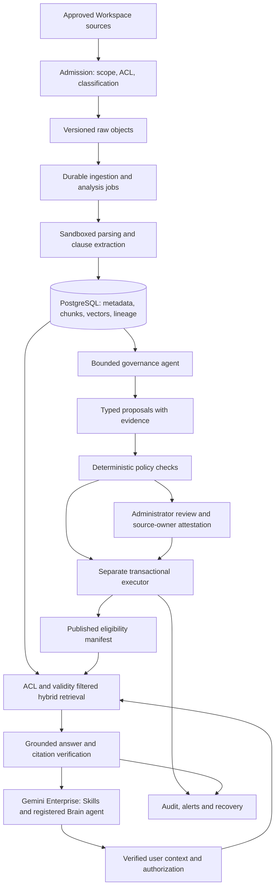

# Cloudasta's Brain — Production Architecture Proposal

Prepared October 12, 2026. This is a target design and release plan, not a claim that the existing demo is production ready. Task 1 and Task 2 responses are separate, shorter documents.

## 1. Decision and scope

Keep the demo's core separation: **the agent proposes; a policy service authorizes; a separate executor commits; retrieval decides what is eligible for an answer**. Extend it into a permission-aware, monitored service integrated with Gemini Enterprise (GE).

Maintain one application administration role, **Administrator**. Employees query through their existing GE identities and Workspace access rights; this does not require a second role in the governance console. Source owners attest business authority through an approval register, rather than letting the model invent approval. Multiple named administrators may hold the same role; sensitive changes can require a second administrator without introducing another role type.

Start with approved internal SOPs and a narrowly scoped client-account pilot. No source write-back, outbound email, contract execution or irreversible deletion in the first production release. Add connectors only after access and regional processing requirements are verified. All current demo inputs remain fictional.

## 2. What is already built, and what must change

| Area | Working demo | Production target |
|---|---|---|
| Inputs | 30 authored Office/Markdown/text files | Authorized Drive exports and Meet transcripts; later selected Gmail/Chat records |
| Identity | Local administrator without login | Verified Workspace identity, server-side authorization, scoped service identities |
| Storage | Local files and one SQLite state payload | Versioned Cloud Storage objects; normalized, transactional PostgreSQL |
| Retrieval | BM25-style keyword scoring and local 20-dimensional LSA | PostgreSQL full-text retrieval plus evaluated neural embeddings and reranking |
| Agent | Bounded Qwen tool loop | Durable jobs, per-tenant budgets, typed tools, model/prompt versions and checkpoint recovery |
| Governance | Relations, rules, review and rollback | Immutable approval evidence, clause validity intervals, transactional lineage and publication |
| UI | English file library, graph, review, query and audit | Authenticated console, stable source links, accessibility and operational dashboards |
| Evidence | Synthetic-corpus test and two prompt experiments | Independent, owner-labelled holdouts; permissions, recovery and load qualification |

The demo's 12/12 required-pair recall, 11/12 replacement/deduplication proposal precision and 7/8 answer tests are different denominators. None establishes production reliability. Two obsolete SOPs still display pending administrative work; an expired price file displays Active even though query eligibility excludes it. Production must make business validity and workflow status consistent without conflating them.

## 3. Reference deployment

Use Cloud Run for the API and bounded workers, Cloud Workflows for durable orchestration, Pub/Sub for source and publication events, Cloud SQL for PostgreSQL with HA and point-in-time recovery, Cloud Storage for immutable source versions, Secret Manager for credentials, and centralized logging/monitoring. Separate development, staging and production projects and service accounts. Provision with infrastructure as code and deploy signed, scanned images through reviewed CI/CD.

PostgreSQL is the initial transactional and retrieval store; no separate graph or vector database is needed for the first measured workload. Its vector extension supports storing and querying embeddings. Generate embeddings in workers outside database transactions; benchmark full-text and vector performance before adding specialized search infrastructure. [Cloud SQL vector support](https://docs.cloud.google.com/sql/docs/postgres/ai-overview).

Workflows can wait for authenticated callbacks, supporting approval pauses without keeping a worker alive. Persist review state in PostgreSQL; expire abandoned workflow waits and resume using a new execution when needed. [Workflows callbacks](https://docs.cloud.google.com/workflows/docs/creating-callback-endpoints).

## 4. Gemini Enterprise integration and model routing

GE is the staff-facing experience. Two reusable Skills provide the initial workflows: **Current Policy Check** and **Account Brief**. Skills contain reusable instructions; they are not the security or publication boundary. Confirm edition eligibility and that administrators have enabled creation and sharing before the pilot. [GE Skills](https://docs.cloud.google.com/gemini/enterprise/docs/skills).

Register the Brain service as a custom A2A agent, subject to a staging integration test. Keep its Cloud Run endpoint authenticated. Verify both the platform's service identity and the end-user authorization context; never treat a service token, a client-supplied email or an agent's text as proof of the user's document access. Google's documented default Cloud Run integration separates service-to-service authentication from end-user OAuth. [A2A registration and authorization](https://docs.cloud.google.com/gemini/enterprise/docs/register-and-manage-an-a2a-agent).

The registered agent calls only governed retrieval and comparison APIs. Do not attach unrestricted raw-source stores to the Brain's answer path. If a GE data store is also used, export only approved clause views with explicit ACL metadata and verify freshness/revocation behavior. Outside the Brain agent, other GE searches are outside this service's governance guarantee. Native source citations in the GE UI must be tested; the minimum reliable output is an inline source ID, document/version/location and permission-checked source link.

Retain the Qwen adapter behind a model gateway for continuity with the demo. Production model selection is a controlled configuration, not automatic fallback to any available vendor. Evaluate Gemini for the Google environment and Qwen for the governance worker under the same holdout suite. The current Beijing Qwen endpoint has processed fictional data only. Do not route real US client material there without explicit vendor, residency and contractual approval; use an approved regional service or approved private Qwen hosting instead. Provider failure must not silently move data to another region or provider.

Pin generation, embedding, parser, reranker and prompt versions. Record token consumption, cache usage, latency and errors. Validate all output schemas. Disallow tools for arbitrary SQL, shell execution, permission changes or direct publication. Raw model diagnostics and secrets never reach the browser.

## 5. Admission and connector lifecycle

1. Inventory source locations, owners, customer boundaries, sensitivity, current readers, retention and business use. Start with metadata, not indiscriminate content ingestion.
2. Admit only approved locations and processing classes. Exclude credentials, private mailboxes and HR/legal material unless separately authorized for the specific purpose. Apply classification/redaction before embedding or model transmission; quarantined content remains outside the AI index.
3. Implement an initial authorized snapshot plus change cursors/events, bounded retries and daily reconciliation. Capture edits, permission changes, moves, deleted sources and group membership changes; an expired connector lease triggers reconciliation rather than silent data loss.
4. Normalize source identifiers and immutable revisions. A permission update must invalidate retrieval/cache eligibility even if content bytes do not change.
5. Prefer controlled Drive folders first; Meet transcripts are governed Drive artifacts with their own sharing and approval context. Later add opt-in functional Gmail threads and selected Chat spaces; avoid treating conversational agreement as formal approval.

GE connectors differ in their ingestion/federation behavior, required scopes and synchronization. Validate each chosen connector in the actual tenant; do not assume all Workspace products share one permission model. [Connector design considerations](https://docs.cloud.google.com/gemini/enterprise/docs/connectors/introduction-to-connectors-and-data-stores).

## 6. Core data model

| Record | Required information |
|---|---|
| SourceDocument / DocumentVersion | Tenant, customer, immutable source ID/revision/hash, title, MIME type, origin URL, owner, source/modified/business dates, original ACL and ACL revision, classification, retention/hold, approval evidence, authority and applicability |
| Clause / ChunkVersion | Stable clause identity, original text, parsed representation, original location, parent section, unit/currency/time window, parser version, content fingerprint, embedding version, source ACL reference |
| RelationshipProposal | Source/target versions, typed relationship, clause mapping, exact evidence spans, rationale, uncertainty, risk, model/prompt/retrieval snapshot, proposed/edited/rejected status |
| ConfirmedRelationship | Reviewed or allowlisted decision, bound hashes, parent/child mapping, decision maker, approval evidence, business validity interval, transaction ID |
| ReviewTask / Job | Required decision, assignee, due/escalation policy, workflow state, checkpoints, bounded budget, lease and idempotency key |
| Publication / AuditEvent | Published snapshot/manifest, verification result, source and ACL revisions, before/after references, actor, timestamp, reason and rollback/compensation reference |

Keep the demo’s visible fields **Processed?** and **Processed by**, backed by separate data rather than one overloaded status. Store `analysis_status`, `review_status`, `publication_status`, `processed_at`, `processor_type` (agent or administrator), `processor_id`, assigned administrator and evidence/decision references. “Analyzed” means the agent finished its comparison; “Processed” means every required disposition for that version is complete. A file can be analyzed with review pending, and an approved file can be expired. The console must show those distinctions, with the actual named person or versioned agent identity that completed each action. Business owner is separate from processor.

Distinguish `business_valid_from/to` from `recorded_at`: the system needs to explain both what was effective on a date and what evidence it knew then. Business dates and approval are evidence-backed facts, not model-created labels. Unknown dates remain unknown; modification time cannot fill the gap.

## 7. Parsing, retrieval and agent analysis

Parse in isolated workers with MIME verification, size/decompression limits, malware checks and no macro or embedded-code execution. Keep native Office extractors for tables, formulas and notes; add OCR/layout parsing for eligible scanned documents. Preserve the original page/slide/cell/timestamp. Mark OCR confidence and extraction failures, and require review when critical numbers or negations cannot be recovered. Layout services have format and size limitations; verify merged/hidden tables and formula values against native extracts. [Document AI layout parsing](https://docs.cloud.google.com/document-ai/docs/layout-parse-chunk).

Build structure-aware chunks with neighboring context and table headers. Extract normalized claims such as `{subject, requirement, value, unit, scope, period, authority}` while retaining source spans. Match clauses semantically and structurally; do not rely only on identical section keys. Keep neural embeddings independently versioned; re-embedding does not change approval.

Use two enforced retrieval views:

- **Governance:** the analysis job's authorized corpus, including permitted drafts, history and duplicate references. A background service has a restricted corpus grant; a staff member cannot gain its broader access by calling a comparison tool.
- **Answer:** the requesting user's current ACL intersected with tenant/customer scope and the published, approved, effective clause set. Historical comparison is explicit, ACL-filtered and labelled, not a back door into current answers.

Retrieve keyword and vector candidates, fuse and rerank, then aggregate by document. Always add explicit version and dependency references; widen search or report incomplete coverage when evidence is insufficient. Use scope-partitioned retrieval and authorization predicates inside the search operation, never send unrestricted candidates to the model and filter afterwards. Benchmark approximate retrieval recall under selective ACL filters; use exact search within small authorized subsets where necessary.

Schedule initial analysis newest-first by verified business date, preserving a fixed corpus snapshot. For incremental edits, analyze affected versions and invalidate dependent relationships. Newest-first is a scheduling choice, not an authority rule.

The bounded agent reads both sides, compares complete relevant sections, checks missing coverage and emits typed proposals. A no-change outcome explicitly records that candidate search completed without a supported change; it is not an automatic approval. Once an exact duplicate has been safely resolved, stop producing replacement proposals from that alias. Unknown date, conflicting authority, ambiguous coverage, tool-budget exhaustion and risky commitments create review tasks with distinct reasons.

## 8. Authority and safe execution

Resolve applicability first: customer/legal entity, product, workflow, region and time. Within that scope, use owner-verified authority: an executed customer-specific agreement/exception controls its commercial field; an effective approved controlled policy governs general operations; historical policies and templates are context; draft proposals, email, Chat and Meet are evidence of discussion until explicitly ratified. File format never determines authority.

If two equally authoritative sources conflict, block the affected claim and escalate. Do not compare arbitrary chunk text for inequality: the demo's USD 24 false conflict came from complementary segments of byte-identical price files. Canonicalize identical sources and compare normalized claims with aligned scope, units and periods. Model self-confidence is not a calibrated release threshold.

Launch with replacement actions requiring administrator confirmation. Auto-archive only exact duplicates that pass scope, approval, retention and canonical-source checks; no physical deletion. Enable limited low-risk replacements later only after independent precision evidence and owner authorization. Pricing, delivery promises, customer exceptions, access-policy changes, legal holds and ambiguous inheritance always require the applicable business approval evidence and review. Similarity alone never establishes inheritance.

## 9. Version graph and clause publication

Confirmed version relationships form a DAG with multiple parents/children. Full replacement, partial replacement, merge and split carry explicit clause mappings. Duplicate/related/dependency/coexistence links are separate context edges; context cycles do not become version cycles. Keep proposed and rejected edges distinct from confirmed ancestry.

Reject self-links, cycles, unverifiable chronology and coverage gaps. Graph titles, edges, evidence, counts and exports must themselves be ACL-filtered. A user should not infer a confidential document's existence from a graph edge.

Overlapping active children covering the same parent clause are competing branches. Pause automatic publication until an administrator identifies scope, chooses a controlling branch, or creates an approved merge. Partial replacement retires only covered clauses; unaffected content stays eligible. A newer QBR does not retire an earlier reporting period. Scheduled activation/expiry jobs recalculate validity even without file edits.

## 10. Transactions, concurrency and recovery

Bind approval to document versions, clause mapping, approval evidence, ACL revision and policy version. The executor rechecks them under a serializable transaction or scoped row locks. Include all active overlapping edges when checking cycles and branches; simultaneous approvals cannot both pass a stale precheck.

Stage parsing/embeddings, verify completeness, then atomically switch the published manifest in PostgreSQL with lineage and audit records. With separate indexes, use an outbox-driven publisher and read-time manifest checks; do not rely on eventually consistent vector deletion. Publish the new eligible version before retiring its predecessor. If a source is known unsafe, revoked or materially invalid, block it immediately rather than serving stale content during recovery.

Use at-least-once delivery with idempotent effects keyed by tenant, document revision, parser/model/policy versions and snapshot. Checkpoint each file; dead-letter repeated failures, expose retry status and alert an owner. A timed-out proposal is not a committed decision. Crash/retry must not duplicate relationships or notifications.

Audit records are append-only and exported to retention-protected storage according to approved policy; restrict sensitive trace access and redact logs. Recovery creates a new compensating publication referencing the original event. It never restores revoked permissions, overwrites newer valid changes or reactivates expired/unsafe sources. Test database point-in-time restore and object restoration together.

## 11. Answer and sharing contract

Resolve verified user context and an explicit customer/as-of date. Fetch only authorized eligible evidence; generate concise claims with cited immutable versions and exact locations. Deterministically check citation existence, quoted text, numbers, dates and publication membership; add independent entailment checking and sampled human review. An LLM verifier is additional evidence, not a security guarantee.

Return separate facts, proposals and uncertainty. Say “I don't have sufficient approved evidence” when appropriate. Before delivery, recheck publication and ACL revisions; cancel/retry if they changed. Source links must enforce current access. Downloaded briefs inherit the intersection of source sharing permissions; cross-document summaries must not broaden access.

Cache keys include tenant, user/ACL scope, customer, as-of date, publication revision and model/prompt version. Invalidate on source or access changes; fail closed on missing authorization state. Never store a sensitive prompt or generated answer in general analytics.

## 12. Security and operations

- Workspace SSO/OIDC, MFA through organizational policy, short-lived service credentials, least-privilege IAM, database row-level controls and separate source/worker/publisher identities.
- Private database connectivity, encrypted transport/storage, controlled egress, regional model allowlists and managed secret rotation. Customer-managed keys and perimeter controls only where required and supported; test their actual coverage.
- Prompt injection controls at tool boundaries: documents cannot authorize tool calls, source writes, email sends, permission changes or data export. Test hostile text inside files and malformed tool output.
- Revocation is a deny event: remove eligibility/cached answers first, reconcile indexes second. Recheck source rights for sensitive responses and block when freshness guarantees cannot be met.
- Separate health checks for model, connector, publisher and retrieval. Alerts for access anomalies, stale approvals/ACLs, publication lag, dead-letter growth, unsupported claims and budget overruns.
- CI gates for parser fixtures, ACL leakage, source-of-truth cases, concurrency, migrations, rollback and restoration. Canary new models/prompts against a fixed holdout before promotion; preserve previous versions for rollback.

ACL controls must be explicitly configured on custom GE data stores; attaching source content alone does not transfer the original permissions. [Custom-source ACL configuration](https://docs.cloud.google.com/gemini/enterprise/docs/identity).

## 13. Qualification and operating targets

Agree targets with the CEO and IT lead; these are proposed acceptance criteria, not measured achievements:

| Area | Initial release gate / target |
|---|---|
| Authorization | No observed cross-client or unauthorized disclosure in negative/derived-output tests; verified revocation path. Any observed leak blocks release. |
| Evidence | At least 95% correct answers on an independent answerable set; at least 99% supported factual claims and 95% correct abstention/escalation on unanswerable/conflicting cases, with denominators and confidence intervals. |
| Retrieval | At least 95% recall of labelled relevant version pairs at the chosen retrieval budget; evaluate within restrictive ACL scopes. |
| Automated changes | Exact duplicates only initially. Before broader autonomy, evaluate at least 1,000 eligible action cases plus adversarial cases, independently reviewed and stratified; zero observed critical errors is necessary, not proof of zero risk. With zero errors in 1,000 cases, the approximate 95% upper error bound is still 0.3%. |
| Reliability | 99.5% monthly query-service availability target; p95 answered query within 15 seconds under agreed load; explicit abstention during unsafe outages. |
| Freshness | Target content publication within 15 minutes of approved-source changes; access revocations block delivery at authorization check, with event-driven cache invalidation target under 60 seconds. Measure what each connector actually supports. |
| Recovery | Proposed RPO ≤15 minutes and RTO ≤4 hours; demonstrate in a restoration drill before release. Revoked ACLs must be reapplied before reopened service. |
| Human work | Normal reviews within two business days; urgent unsafe sources blocked immediately. Track actionable-review rate and time per decision. |

Collect held-out cases from source owners, separated by customer and version family to prevent leakage. Test repeated runs and new versions, changed units, missing dates, scanned tables, source withdrawal, legal holds, near duplicates, competing successors, changed ACLs, prompt injection and model outages. Publish per-slice metrics, not one aggregate “accuracy.”

## 14. Rollout and responsibilities

**Days 1–30:** CEO selects two workflows and accountable owners; platform administrator inventories access, confirms regional model choice and runs dry-run cleanup. A small champion group uses the two Skills with approved pilot sources. All replacements remain suggestions. Establish baseline task times and a labelled evaluation set.

**Days 31–60:** Validate GE identity propagation and governed retrieval in staging, add the approved Drive pilot, operate weekly owner reviews and monitor permission/publication freshness. Run office hours and test staff on their own workflows. Keep current scope if quality or security gates fail.

**Days 61–90:** Expand only after quality, security, restoration and adoption gates pass. Add selected conversational sources and limited duplicate automation; keep high-risk changes reviewed. Assign an operational owner, on-call contact, support runbook and monthly model/source review. Budget for token usage, embeddings, storage, database, OCR, logs and human review; measure cost per useful completed workflow.

Track weekly meaningful-workflow users, two-week repeat use, accepted answer rate, verified time saved, source coverage/freshness, review backlog, correction rate, cost and client incidents. Compare the same tasks before/after, report respondent and task counts, and validate savings with users instead of trusting model estimates. Map these to Cloudasta's actual scorecard once provided; its definitions are currently unknown.

## 15. Implementation order and release blockers

1. Repair known demo defects: compare claims rather than unequal chunk strings; add no-change completion; stop duplicate aliases from generating replacement work; synchronize future/expired status; invalidate unknown-date version links.
2. Normalize persistence and add authorization/admission, immutable approval records and per-clause validity. Migrate existing synthetic records with a schema/versioned migration; keep the old evaluation immutable.
3. Add durable ingestion, model gateway, neural retrieval, transactional publication and permission-safe graph/query APIs.
4. Register and test the GE Brain agent and Skills; rehearse fallbacks without claiming a license or connector test that has not occurred.
5. Pass independent quality, security, load and recovery gates; launch restricted pilot before expanding autonomy.

This document is implementation guidance, not a deployed production release. The original Chinese architecture PDF was unavailable at the user-supplied path; this proposal uses the assignment PDF, current repository architecture, source code and recorded evaluations. Product integration details were checked against official Google documentation on October 12, 2026, but still require tenant-specific validation.
